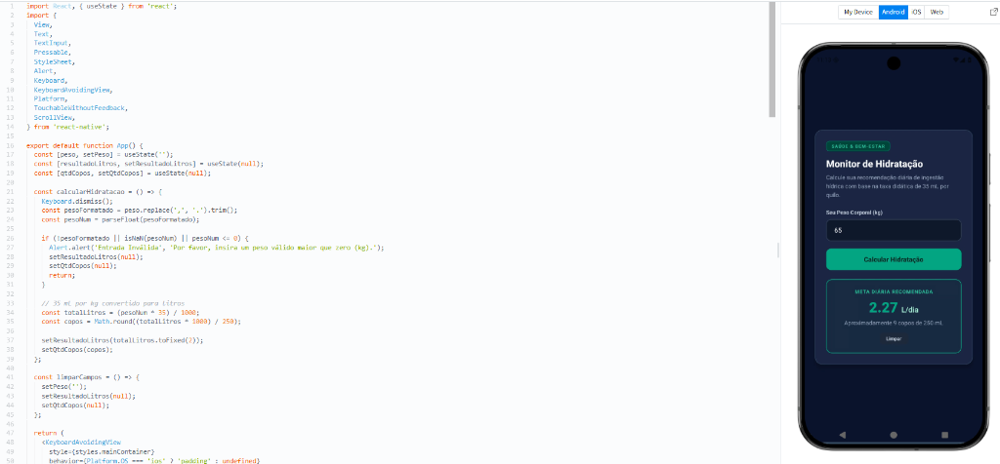

# 💧 Monitor de Hidratação Diária (Questão 01)

**Aluno:** Pedro Alexandrino Rodrigues da Rocha  
**Disciplina:** Desenvolvimento para Dispositivos Móveis  
**Instituição:** Universidade Federal Rural da Amazônia (UFRA) - Campus Capitão Poço

---

## 📱 Descrição do Aplicativo
Aplicativo desenvolvido em **React Native** com **Expo** para estimar didaticamente a ingestão hídrica diária com base na proporção médica padrão de **35 mL por quilo corporal**.

### ✨ Recursos Implementados:
- **Entrada e Validação:** Entrada do peso corporal com suporte a vírgula e ponto decimal.
- **Validação de Segurança:** Bloqueia cálculos para valores nulos, vazios, não numéricos ou menores/iguais a zero.
- **Resultado em Litros:** Exibição clara do consumo recomendado em litros/dia e sugestão de copos d'água (~250ml).
- **Interface Otimizada:** Layout moderno com paleta Esmeralda e Dark Navy, teclado numérico e ScrollView responsiva.

---

## 🚀 Como Executar
```bash
cd questao01
npm install
npx expo start
```

---

## 📸 Demonstração do Aplicativo

### Demonstração no Snack e Expo Go


