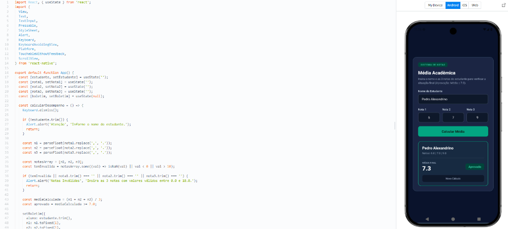

# 🎓 Avaliação de Desempenho Acadêmico (Questão 02)

**Aluno:** Pedro Alexandrino Rodrigues da Rocha  
**Disciplina:** Desenvolvimento para Dispositivos Móveis  
**Instituição:** Universidade Federal Rural da Amazônia (UFRA) - Campus Capitão Poço

---

## 📱 Descrição do Aplicativo
Sistema acadêmico em React Native para cálculo de média aritmética de três avaliações e verificação de situação do aluno (Média ≥ 7,0 = Aprovado).

### ✨ Funcionalidades
- **Entrada Completa:** Nome do discente e 3 notas individuais.
- **Validação Rigorosa:** Garante que todas as 3 notas estejam no intervalo válido de 0,0 a 10,0.
- **Feedback Visual:** Status "Aprovado" em destaque verde e "Reprovado" em destaque vermelho.
- **Formatação Decimal:** Médias e notas formatadas para padrão decimal brasileiro.

---

## 📸 Demonstração do Aplicativo

### Demonstração no Snack e Expo Go

