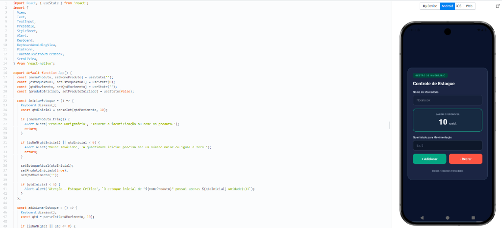
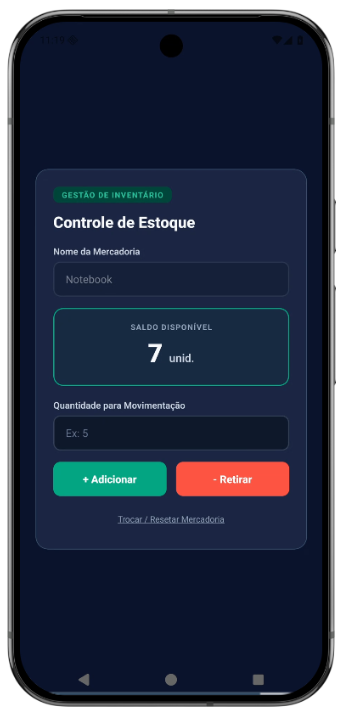

# 📦 Controle de Estoque (Questão 03)

**Aluno:** Pedro Alexandrino Rodrigues da Rocha  
**Disciplina:** Desenvolvimento para Dispositivos Móveis  
**Instituição:** Universidade Federal Rural da Amazônia (UFRA) - Campus Capitão Poço

---

## 📱 Descrição do Aplicativo
Aplicativo para acompanhamento de movimentações (entradas e saídas) de mercadorias no estoque, com bloqueio de quebra de estoque e alerta para reposição quando restarem menos de 5 unidades.

### ✨ Funcionalidades
- **Definição de Produto:** Configuração inicial de nome e lote inicial.
- **Entrada e Saída:** Botões específicos para adicionar ou retirar unidades.
- **Proteção contra Saldo Negativo:** Impede retiradas superiores à quantidade disponível em estoque.
- **Alerta de Estoque Baixo:** Emite aviso visual e notificação quando o estoque for menor que 5 itens.

---

## 📸 Demonstração do Aplicativo

### Visão Geral do Código e Simulador no Snack

### Execução no Dispositivo Móvel

