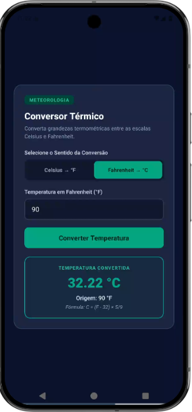

# 🌡️ Conversor de Temperatura (Questão 04)

**Aluno:** Pedro Alexandrino Rodrigues da Rocha  
**Disciplina:** Desenvolvimento para Dispositivos Móveis  
**Instituição:** Universidade Federal Rural da Amazônia (UFRA) - Campus Capitão Poço

---

## 📱 Descrição do Aplicativo
Conversor termométrico bidirecional entre escalas Celsius (°C) e Fahrenheit (°F), desenvolvido em React Native.

### 📐 Fórmulas Utilizadas:
- **Celsius para Fahrenheit:** `F = (C × 9/5) + 32`
- **Fahrenheit para Celsius:** `C = (F - 32) × 5/9`

### ✨ Funcionalidades
- Seletor de direção de conversão (Tabs interativas).
- Suporte a decimais e números negativos (ex: temperaturas abaixo de zero).
- Apresentação visual da fórmula e do resultado convertido.

---

## 📸 Demonstração do Aplicativo

### Execução no Dispositivo Móvel

