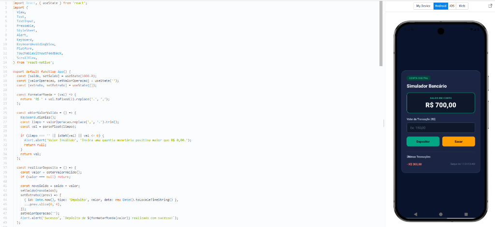

# 🏦 Simulador de Conta Bancária (Questão 05)

**Aluno:** Pedro Alexandrino Rodrigues da Rocha  
**Disciplina:** Desenvolvimento para Dispositivos Móveis  
**Instituição:** Universidade Federal Rural da Amazônia (UFRA) - Campus Capitão Poço

---

## 📱 Descrição do Aplicativo
Simulador bancário didático em React Native inicializado com saldo de **R$ 1.000,00**. Permite operações financeiras de depósito e saque com regras de validação.

### ✨ Regras e Funcionalidades
- **Saldo Inicial:** R$ 1.000,00 fixado na inicialização.
- **Depósitos:** Apenas valores positivos e maiores que zero.
- **Saques Protegidos:** Bloqueio de valores superiores ao saldo disponível e valores não positivos.
- **Histórico Operacional:** Exibição do extrato recente de transações efetuadas.

---

## 📸 Demonstração do Aplicativo

### Demonstração no Snack e Expo Go

