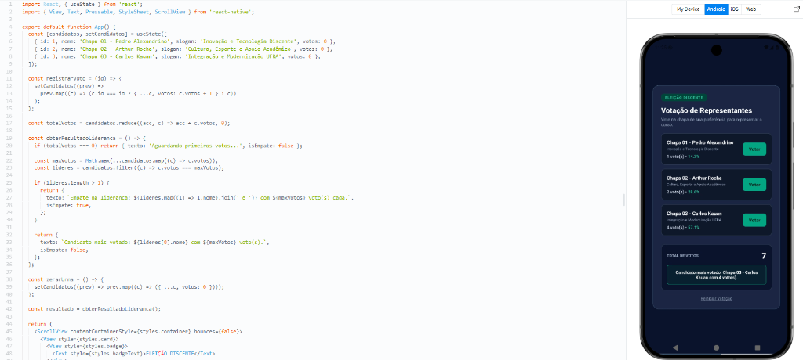

# 🗳️ Urna de Eleição Estudantil (Questão 06)

**Aluno:** Pedro Alexandrino Rodrigues da Rocha  
**Disciplina:** Desenvolvimento para Dispositivos Móveis  
**Instituição:** Universidade Federal Rural da Amazônia (UFRA) - Campus Capitão Poço

---

## 📱 Descrição do Aplicativo
Sistema de votação eletrônica simulada para três chapas/candidatos, com contador de votos, cálculo de percentual, apuração da liderança e detecção de empate.

### ✨ Funcionalidades
- **Três Candidatos Registrados:** Botões individuais para computar votos.
- **Total Geral e Proporção:** Cálculo do total e percentual relativo.
- **Detecção de Empate:** Identifica automaticamente se há empate na maior pontuação ou declara o vencedor.

---

## 📸 Demonstração do Aplicativo

### Demonstração no Snack e Expo Go

