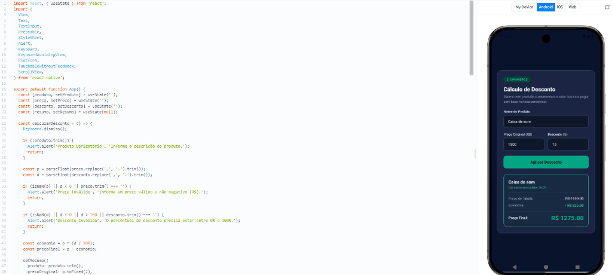

# 🏷️ Calculadora de Descontos (Questão 07)

**Aluno:** Pedro Alexandrino Rodrigues da Rocha  
**Disciplina:** Desenvolvimento para Dispositivos Móveis  
**Instituição:** Universidade Federal Rural da Amazônia (UFRA) - Campus Capitão Poço

---

## 📱 Descrição do Aplicativo
Aplicativo para cálculo imediato de abatimento financeiro em compras de comércio eletrônico, indicando economia e total final.

### ✨ Regras de Negócio e Validações
- **Preço Original:** Não pode ser vazio ou negativo.
- **Percentual de Desconto:** Deve estar rigorosamente entre 0% e 100%.
- **Resumo Financeiro:** Exibe valor economizado e preço a pagar com 2 casas decimais.

---

## 📸 Demonstração do Aplicativo

### Demonstração no Snack e Expo Go

