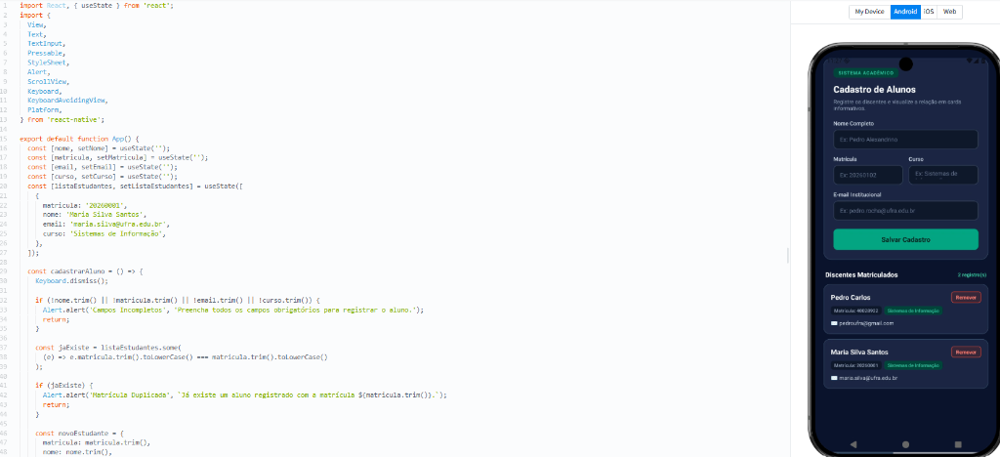

# 📋 Cadastro Acadêmico de Estudantes (Questão 08)

**Aluno:** Pedro Alexandrino Rodrigues da Rocha  
**Disciplina:** Desenvolvimento para Dispositivos Móveis  
**Instituição:** Universidade Federal Rural da Amazônia (UFRA) - Campus Capitão Poço

---

## 📱 Descrição do Aplicativo
Módulo de cadastro e consulta de estudantes universitários, utilizando array de objetos no estado, renderização dinâmica com `map()`, validação de unicidade de matrícula e deleção de registros.

### ✨ Funcionalidades
- **Campos Obrigatórios:** Nome completo, Matrícula institucional, E-mail e Curso.
- **Unicidade de Matrícula:** Impede o cadastramento de matrículas já existentes.
- **Cards com map():** Apresentação organizada em cards individuais.
- **Remoção de Alunos:** Permite excluir registros cadastrados da listagem.

---

## 📸 Demonstração do Aplicativo

### Demonstração no Snack e Expo Go

