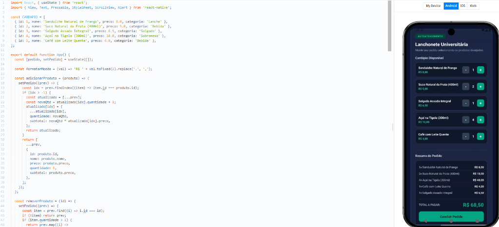

# 🍔 Pedidos de Lanchonete Universitária (Questão 09)

**Aluno:** Pedro Alexandrino Rodrigues da Rocha  
**Disciplina:** Desenvolvimento para Dispositivos Móveis  
**Instituição:** Universidade Federal Rural da Amazônia (UFRA) - Campus Capitão Poço

---

## 📱 Descrição do Aplicativo
Aplicativo de autoatendimento para lanchonete acadêmica que gerencia cardápio com 5 produtos, seleção de itens, cálculo dinâmico de subtotais e resumo final do pedido.

### 🥪 Cardápio Ofertado:
1. Sanduíche Natural de Frango (R$ 8,00)
2. Suco Natural da Fruta 400ml (R$ 5,00)
3. Salgado Assado Integral (R$ 6,50)
4. Açaí na Tigela 300ml (R$ 10,00)
5. Café com Leite Quente (R$ 4,00)

### ✨ Recursos:
- Incremento e decremento rápido de produtos com botões estilizados.
- Lista do pedido contendo quantidade, valor unitário e subtotal individual.
- Totalizador geral em tempo real e botão para finalizar ou limpar o pedido.

---

## 📸 Demonstração do Aplicativo

### Demonstração no Snack e Expo Go

